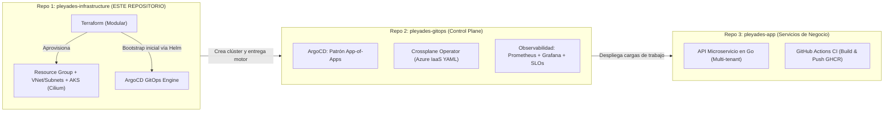
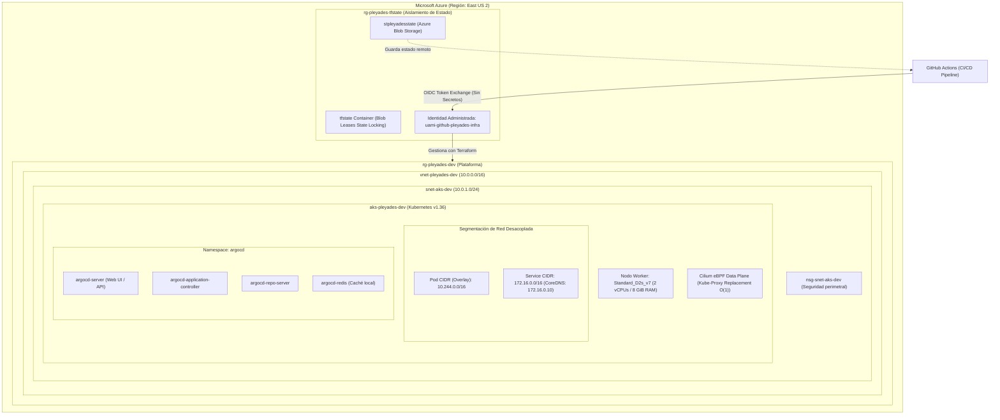

# 🌌 Proyecto Pléyades — Infrastructure as Code (Azure IaaS & Platform Foundation)

[](https://www.terraform.io/)
[](https://azure.microsoft.com/)
[](https://kubernetes.io/)
[](https://cilium.io/)
[](https://argoproj.github.io/cd/)
[](https://www.checkov.io/)
[](https://www.infracost.io/)
[](https://trunkbaseddevelopment.com/)

Repositorio base de **Infraestructura como Código (IaC)** para la plataforma **Pléyades**. Aprovisiona de forma automatizada, idempotente y segura los cimientos en la nube de Microsoft Azure: red privada virtual, clúster gestionado de Kubernetes (AKS) con plano de datos de alto rendimiento basado en **Cilium eBPF nativo**, seguridad federada **Zero Static Secrets (Azure OIDC)** y el motor GitOps **ArgoCD** preinstalado.

---

## 📑 Tabla de Contenidos
- [1. Visión Global y Filosofía del Proyecto](#1-visión-global-y-filosofía-del-proyecto)
- [2. Arquitectura de Infraestructura](#2-arquitectura-de-infraestructura)
- [3. ¿Por qué está diseñado así? (Decisiones Arquitectónicas)](#3-por-qué-está-diseñado-así-decisiones-arquitectónicas)
- [4. Estructura del Repositorio](#4-estructura-del-repositorio)
- [5. Prerrequisitos de Ejecución](#5-prerrequisitos-de-ejecución)
- [6. Guía de Despliegue Paso a Paso](#6-guía-de-despliegue-paso-a-paso)
- [7. Verificación y Operación en Vivo](#7-verificación-y-operación-en-vivo)
- [8. FinOps: Detención y Destrucción Limpia](#8-finops-detención-y-destrucción-limpia)
- [9. Bitácora de Decisiones de Arquitectura (ADRs)](#9-bitácora-de-decisiones-de-arquitectura-adrs)

---

## 🏛️ 1. Visión Global y Filosofía del Proyecto

El proyecto **Pléyades** está diseñado como una plataforma moderna de ingeniería de plataformas (**Internal Developer Platform - IDP**) y confiabilidad (**SRE**) desacoplada en **3 repositorios independientes**:



### Principios Fundamentales
* **100% Declarativo:** Nada se crea manualmente desde el portal web de Azure.
* **Zero Static Secrets:** Eliminación total de credenciales fijas, tokens o contraseñas quemadas en Git o CI/CD; se utiliza **OpenID Connect (OIDC)** con identidades administradas en Microsoft Entra ID.
* **Reproducibilidad Absoluta:** Un único pipeline de Terraform levanta toda la infraestructura desde cero hasta dejar ArgoCD operando.

---

## 🌐 2. Arquitectura de Infraestructura



---

## 🎯 3. ¿Por qué está diseñado así? (Decisiones Arquitectónicas)

### 1. Cilium eBPF nativo con Kube-Proxy Replacement (KPR)
* **El Problema tradicional:** El enrutamiento convencional de Kubernetes depende de `iptables`. A medida que crecen los servicios, `iptables` evalúa listas secuenciales de reglas en el kernel ($O(N)$), aumentando la latencia de red.
* **Nuestra Solución:** Utilizamos **Azure CNI Powered by Cilium**. Cilium inyecta pequeños programas en el bytecode del kernel de Linux (**eBPF**) e intercepta el tráfico directamente en los sockets. El balanceo de carga se realiza mediante **tablas Hash BPF en memoria ($O(1)$)**, logrando rendimiento de red ultra-bajo en latencia y observabilidad nativa.

### 2. Desacoplamiento de Rangos de Red (CIDRs)
* **El Problema:** Azure CNI Overlay asigna por defecto `10.0.0.0/16` para los servicios (`service_cidr`). Como nuestra VNet principal utiliza `10.0.0.0/16` y la subred de nodos `10.0.1.0/24`, el aprovisionamiento fallaba por colisión (`ServiceCidrOverlapExistingSubnetsCidr`).
* **Nuestra Solución:** Segmentamos la red en tres espacios independientes que nunca colisionan:
  - **Red Física / VNet:** `10.0.0.0/16` (Nodos en `10.0.1.0/24`).
  - **Red de Pods (Overlay Cilium):** `10.244.0.0/16`.
  - **Red Virtual de Servicios (ClusterIP):** `172.16.0.0/16` (CoreDNS en `172.16.0.10`).

### 3. Sizing y FinOps (`Standard_D2s_v7`)
* La suscripción de Azure cuenta con un límite regional estricto de **4 vCPUs** en `eastus2`.
* Se auditó la región mediante la API de Azure Resource Manager y se seleccionó la última generación **`Standard_D2s_v7`** (Intel Xeon Platinum Emerald Rapids, 2 vCPUs, 8 GiB RAM), la cual cuenta con **0 restricciones** a nivel de suscripción y zonas.
* El clúster se configuró con **1 nodo inicial y auto-escalado máximo a 2 nodos** ($2 \times 2 = 4 \text{ vCPUs}$), garantizando que nunca se exceda la cuota ni se generen costos imprevistos.
* Tras levantar AKS y todo ArgoCD, **quedan más de 5 GB de RAM libres** para cargas de trabajo.

### 4. Bootstrap Automatizado de ArgoCD (Resuelve el "Huevo y la Gallina")
* Para evitar que un operador humano tenga que ejecutar `kubectl apply` manualmente tras crear el clúster, el provider oficial `hashicorp/helm` de Terraform instala automáticamente el chart oficial de ArgoCD (`argo/argo-cd` v7.7.16 / ArgoCD v2.13.3).
* Se optimizó a **Single-Replica** sin dependencias pesadas de Redis HA o Dex, manteniendo el consumo de ArgoCD por debajo de 500 MB de RAM.

---

## 📂 4. Estructura del Repositorio

El proyecto sigue una arquitectura modular estricta donde la raíz actúa como orquestador y delega en módulos cohesivos:

```text
pleyades-infrastructure/
├── .github/
│   └── workflows/
│       └── deploy.yml              # Pipeline CI/CD desacoplado por jobs paralelos
├── modules/
│   ├── resource_group/             # Aprovisionamiento del RG contenedor
│   │   ├── main.tf, variables.tf, outputs.tf, locals.tf
│   │
│   ├── networking/                 # VNet, Subnet de AKS y NSG asociado
│   │   ├── main.tf, variables.tf, outputs.tf, locals.tf
│   │
│   ├── aks/                        # Clúster AKS, Cilium eBPF, OIDC y Node Pool
│   │   ├── main.tf, variables.tf, outputs.tf, locals.tf
│   │
│   └── argocd/                     # Helm Release oficial de ArgoCD (GitOps Engine)
│       ├── main.tf, variables.tf, outputs.tf, locals.tf
│
├── main.tf                         # Orquestador raíz y configuración de providers (Azure, Helm)
├── variables.tf                    # Parámetros globales con valores por defecto auditados
├── outputs.tf                      # Endpoints, IDs y credenciales expuestas
├── locals.tf                       # Convenciones de nomenclatura y tags globales
├── .terraform.lock.hcl             # Bloqueo determinista de versiones de providers
└── README.md                       # Documentación técnica del proyecto
```

---

## 📋 5. Prerrequisitos de Ejecución

Para operar o desplegar esta infraestructura necesitas:

1. **Herramientas de Línea de Comandos:**
   - [Terraform](https://developer.hashicorp.com/terraform/install) `>= 1.5.0` (recomendado `1.11.x` o superior).
   - [Azure CLI](https://learn.microsoft.com/en-us/cli/azure/install-azure-cli) `>= 2.60.0`.
   - [kubectl](https://kubernetes.io/docs/tasks/tools/) `>= 1.30.0`.
   - [GitHub CLI (`gh`)](https://cli.github.com/) (opcional, para gestión de PRs).
2. **Suscripción de Microsoft Azure:**
   - Una suscripción activa (Free Tier, Estudiante o Pay-as-you-go).
   - Cuota regional mínima de 4 vCPUs en la región seleccionada (por defecto `eastus2`).

---

## 🚀 6. Guía de Despliegue Paso a Paso

### Paso 1: Bootstrap Inicial del Backend Remoto y OIDC (Una sola vez)

Antes de ejecutar Terraform por primera vez, se deben crear los recursos de almacenamiento del estado y la identidad federada para GitHub Actions. Ejecuta en **PowerShell**:

```powershell
# 1. Definición de variables de entorno
$LOCATION         = "eastus2"
$RG_STATE_NAME    = "rg-pleyades-tfstate"
$STORAGE_ACC_NAME = "stpleyadesstate" # Debe ser globalmente único
$CONTAINER_NAME   = "tfstate"
$IDENTITY_NAME    = "uami-github-pleyades-infra"
$GITHUB_ORG       = "<TU_USUARIO_O_ORG>"
$GITHUB_ORG_ID    = "<NUMERIC_ORG_ID>"       # Obtenido desde GitHub API u OIDC claim
$GITHUB_REPO      = "pleyades-infrastructure"
$GITHUB_REPO_ID   = "<NUMERIC_REPO_ID>"      # Obtenido desde GitHub API u OIDC claim

# 2. Crear Resource Group y Storage Account para el tfstate
az group create --name $RG_STATE_NAME --location $LOCATION
az storage account create `
  --name $STORAGE_ACC_NAME `
  --resource-group $RG_STATE_NAME `
  --location $LOCATION `
  --sku Standard_LRS `
  --allow-blob-public-access false

az storage container create `
  --name $CONTAINER_NAME `
  --account-name $STORAGE_ACC_NAME `
  --auth-mode login

# 3. Crear User-Assigned Managed Identity
az identity create --name $IDENTITY_NAME --resource-group $RG_STATE_NAME --location $LOCATION

$PRINCIPAL_ID = az identity show --name $IDENTITY_NAME -g $RG_STATE_NAME --query "principalId" -o tsv
$STORAGE_ID   = az storage account show --name $STORAGE_ACC_NAME -g $RG_STATE_NAME --query "id" -o tsv
$SUB_ID       = az account show --query "id" -o tsv

# 4. Asignar Roles de Mínimo Privilegio
az role assignment create --assignee $PRINCIPAL_ID --role "Storage Blob Data Contributor" --scope $STORAGE_ID
az role assignment create --assignee $PRINCIPAL_ID --role "Contributor" --scope "/subscriptions/$SUB_ID"

# 5. Crear Credenciales Federadas (OIDC) para GitHub Actions
# Para Pull Requests:
az identity federated-credential create `
  --name "gha-pull-requests" `
  --identity-name $IDENTITY_NAME `
  --resource-group $RG_STATE_NAME `
  --issuer "https://token.actions.githubusercontent.com" `
  --subject "repo:${GITHUB_ORG}@${GITHUB_ORG_ID}/${GITHUB_REPO}@${GITHUB_REPO_ID}:pull_request" `
  --audiences "api://AzureADTokenExchange"

# Para Push a Main:
az identity federated-credential create `
  --name "gha-main-branch" `
  --identity-name $IDENTITY_NAME `
  --resource-group $RG_STATE_NAME `
  --issuer "https://token.actions.githubusercontent.com" `
  --subject "repo:${GITHUB_ORG}@${GITHUB_ORG_ID}/${GITHUB_REPO}@${GITHUB_REPO_ID}:ref:refs/heads/main" `
  --audiences "api://AzureADTokenExchange"

# Para Entorno de Producción:
az identity federated-credential create `
  --name "gha-prod-env" `
  --identity-name $IDENTITY_NAME `
  --resource-group $RG_STATE_NAME `
  --issuer "https://token.actions.githubusercontent.com" `
  --subject "repo:${GITHUB_ORG}@${GITHUB_ORG_ID}/${GITHUB_REPO}@${GITHUB_REPO_ID}:environment:production" `
  --audiences "api://AzureADTokenExchange"
```

### Paso 2: Configuración de Secretos en GitHub

En tu repositorio de GitHub (**Settings ➔ Secrets and variables ➔ Actions**), configura las siguientes variables:

| Nombre del Secret | Descripción |
| :--- | :--- |
| `AZURE_CLIENT_ID` | Client ID de la User-Assigned Managed Identity. |
| `AZURE_TENANT_ID` | Tenant ID de tu directorio de Microsoft Entra ID. |
| `AZURE_SUBSCRIPTION_ID` | ID de tu suscripción de Microsoft Azure. |
| `INFRACOST_API_KEY` | *(Opcional)* API key gratuita de Infracost para reportes de costo en PRs. |

### Paso 3: Flujo de Despliegue GitOps (Trunk-Based Development)

1. Crea una rama corta desde `main`:
   ```bash
   git checkout -b feat/mi-mejora
   ```
2. Realiza tus cambios y abre un Pull Request.
3. El pipeline de CI ejecutará en paralelo:
   - Formateo (`terraform fmt`)
   - Análisis estático (`tflint`)
   - Escaneo de seguridad con Checkov
   - Estimación de costos con Infracost
   - Plan de Terraform (`terraform plan`)
4. Al hacer **Squash and Merge** hacia `main`, el pipeline ejecutará automáticamente `terraform apply` y aprovisionará la infraestructura en Azure sin intervención manual.

### Paso 4: Ejecución Local (Alternativa para desarrollo/pruebas)

Si deseas planificar o aplicar localmente:

```powershell
# Iniciar sesión en Azure
az login

# Inicializar Terraform descargando módulos y providers
terraform init

# Validar sintaxis
terraform validate

# Generar y revisar el plan de ejecución
terraform plan -out=tfplan

# Aplicar los cambios
terraform apply "tfplan"
```

---

## 🔍 7. Verificación y Operación en Vivo

Una vez aprovisionada la infraestructura, puedes interactuar directamente con el clúster:

### 1. Conexión con `kubectl`
Descarga las credenciales del clúster a tu máquina local:
```powershell
az aks get-credentials --resource-group rg-pleyades-dev --name aks-pleyades-dev --overwrite-existing
```

### 2. Verificar Nodos y Consumo
```powershell
# Ver estado de los nodos
kubectl get nodes -o wide

# Ver consumo real de CPU y memoria en el nodo
kubectl top nodes
```

### 3. Verificar Cilium eBPF en el Kernel
```powershell
# Inspeccionar la salud de Cilium eBPF
kubectl -n kube-system exec $(kubectl -n kube-system get pods -l k8s-app=cilium -o jsonpath='{.items[0].metadata.name}') -c cilium-agent -- cilium status

# Ver la tabla de balanceo de carga en memoria BPF (Kube-Proxy Replacement)
kubectl -n kube-system exec $(kubectl -n kube-system get pods -l k8s-app=cilium -o jsonpath='{.items[0].metadata.name}') -c cilium-agent -- cilium service list
```

### 4. Acceder a la Interfaz Web de ArgoCD
Como el servidor de ArgoCD está optimizado en modo HTTP seguro (`--insecure`), puedes crear un túnel local hacia el clúster:

```powershell
# Abrir túnel seguro local hacia el puerto 80 del servicio
kubectl port-forward svc/argocd-server -n argocd 8080:80
```

1. Abre en tu navegador: [http://localhost:8080](http://localhost:8080)
2. Obtén la contraseña inicial de administrador:
   ```powershell
   kubectl -n argocd get secret argocd-initial-admin-secret -o jsonpath="{.data.password}" | ForEach-Object { [System.Text.Encoding]::UTF8.GetString([System.Convert]::FromBase64String($_)) }
   ```
3. Inicia sesión con usuario **`admin`** y la contraseña obtenida.

---

## 💰 8. FinOps: Detención y Destrucción Limpia

Para evitar costos cuando no estés utilizando el laboratorio:

### Opción A: Detener el Clúster (Ahorro del 90% de costos)
Puedes detener el clúster desde Azure CLI sin perder tu configuración ni los datos de los discos:
```powershell
# Apagar el cómputo de AKS (las VMs se desasignan, no te cobran CPU ni RAM)
az aks stop --resource-group rg-pleyades-dev --name aks-pleyades-dev

# Reanudar cuando vuelvas a trabajar
az aks start --resource-group rg-pleyades-dev --name aks-pleyades-dev
```

### Opción B: Destrucción Total
Si deseas destruir todos los recursos de la plataforma:
```powershell
terraform destroy -auto-approve
```
*(Nota: El backend remoto en `rg-pleyades-tfstate` se preserva para mantener el historial).*

---

## 📜 9. Bitácora de Decisiones de Arquitectura (ADRs)

Todas las decisiones técnicas están documentadas formalmente siguiendo el estándar ADR:

| ADR | Título | Decisión Resumida |
| :---: | :--- | :--- |
| **01** | [Metodología Git](https://trunkbaseddevelopment.com/) | Trunk-Based Development con ramas de vida corta y merges atómicos. |
| **02** | Scaffolding Modular | Desacoplamiento por módulos en `modules/` con estándar de 4 archivos. |
| **03** | Backend Remoto en Azure | Storage Account dedicado con Azure Blob Leases para bloqueo de estado (*state locking*). |
| **04** | Seguridad Zero Secrets | Azure OIDC con Identidad Administrada e Immutable Subject Claims. |
| **05** | Pipeline Concurrente | Desacoplamiento en jobs paralelos en GitHub Actions (lint, sec, cost, plan, apply). |
| **06** | Cilium eBPF & Sizing | Selección de `Standard_D2s_v7` en `eastus2` y desacoplamiento de CIDRs (`172.16.0.0/16`). |
| **07** | Bootstrap de ArgoCD | Instalación automatizada e idempotente de ArgoCD vía Terraform Helm Provider. |

---

<p align="center">
  <b>Proyecto Pléyades</b> • Diseñado y construido por <b>Juan Diego López Zuluaga</b><br/>
  <i>DevOps, Cloud Platform & SRE Engineer</i>
</p>
